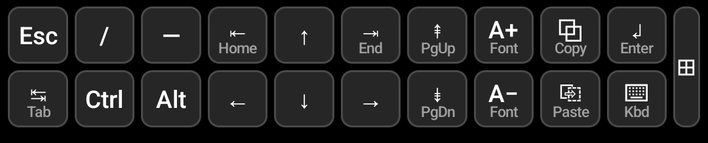
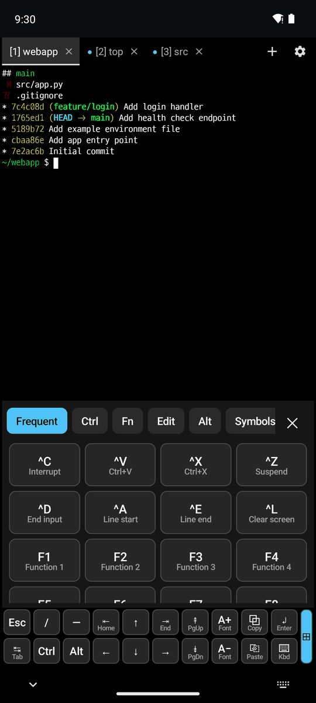
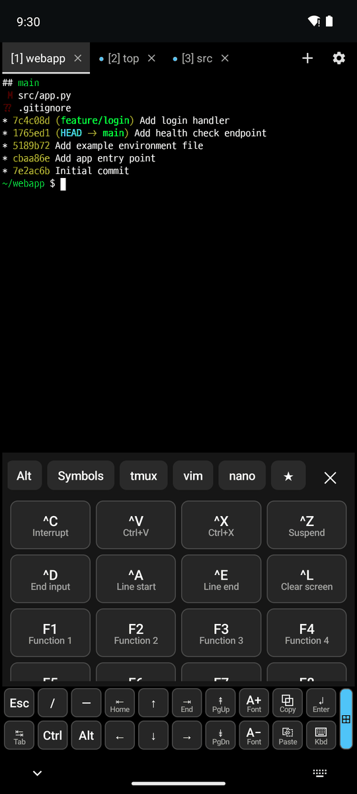
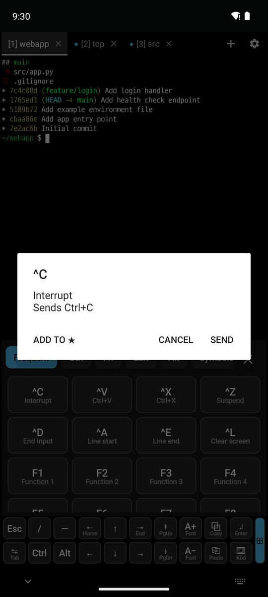
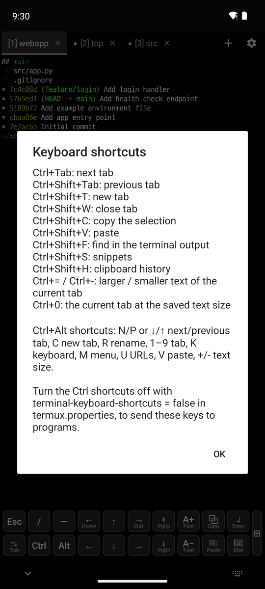

# 1. Keyboard and input

[← Contents](README.md) · [Next: Display and fonts →](2-display.md)

## Extra keys

The two rows of keys below the terminal. They are drawn as keycaps, with an icon and a small name on each key.

| Key | Action |
|---|---|
| **↲ Enter** | Enter |
| **⌨ Kbd** | Show or hide the on-screen keyboard |
| **A+ / A−** | Make the text of the current tab larger or smaller (not saved) |
| **⧉ Copy** | Copy the selection. **Swipe up** to copy the whole screen |
| **⎘ Paste** | Paste. **Swipe up** to open the [clipboard history](4-snippets-clipboard.md#clipboard-history) |
| **Ctrl / Alt** | Turns on (blue) and is sent with the next key |
| **⊞** | Opens the [special keys panel](#special-keys-panel) |

- To go back to the old look, put `extra-keys-style = default` in `~/.termux/termux.properties`.
- In your own layout you can use the `SNIPPETS`, `CLIPBOARD`, `COPY_SCREEN` and `SPECIAL_KEYS` keys, and make tall or narrow keys like `{key: 'X', rows: 2, width: 0.5}`.

## Special keys panel

Tap **⊞** at the right end of the extra keys. It has 10 tabs (Frequent, Ctrl, Fn, Edit, Alt, Symbols, tmux, vim, nano, ★), and every key has a description under it.

  

1. Swipe the tabs to pick a group (middle: the tmux tab).
2. Tap a key to send it and keep the panel open for repeated presses. Tap ✕ or the ⊞ key again to close it. Ctrl/Alt turned on in the extra keys are sent with it.
3. **Long press** a key to see what it sends (right). **Add to ★** collects it in the ★ tab.

## Hardware keyboard

- You can type Korean with a Bluetooth/USB keyboard, and the character being composed is shown at the cursor.
- Switching tabs drops the character being composed, so it does not end up in another tab.
- **⚙ → Keyboard shortcuts** lists the shortcuts.

| Shortcut | Action |
|---|---|
| Ctrl+Tab / Ctrl+Shift+Tab | Next/previous tab |
| Ctrl+Shift+T / Ctrl+Shift+W | New tab / close tab |
| Ctrl+Shift+C / Ctrl+Shift+V | Copy / paste |
| Ctrl+Shift+F | Find in the output |
| Ctrl+Shift+S | Snippets |
| Ctrl+Shift+H | Clipboard history |
| Ctrl+= / Ctrl+− / Ctrl+0 | Larger/smaller/saved text size for the current tab |

Turn the shortcuts off with `terminal-keyboard-shortcuts = false`.
