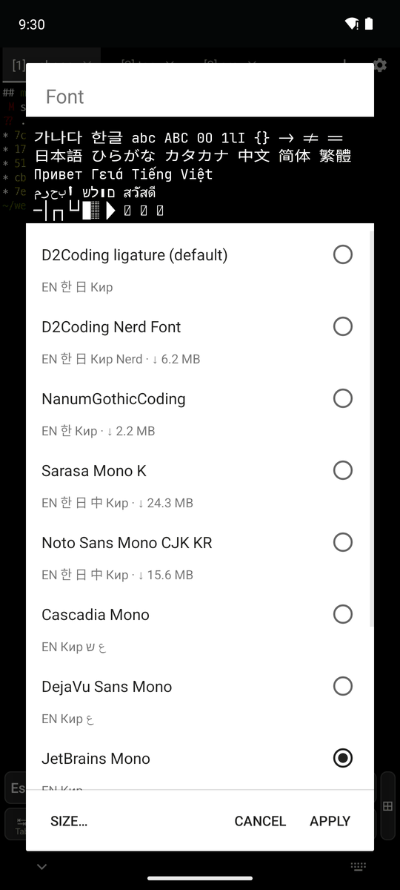
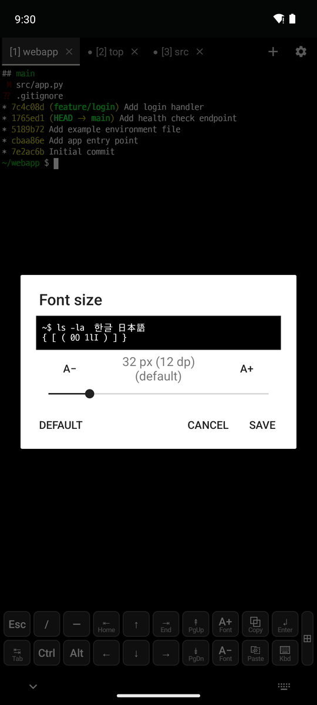
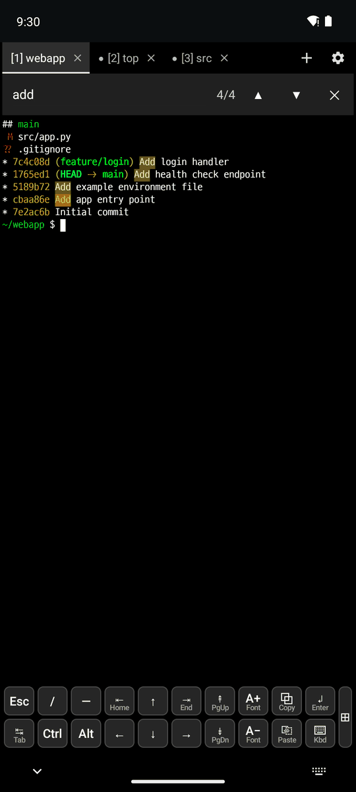
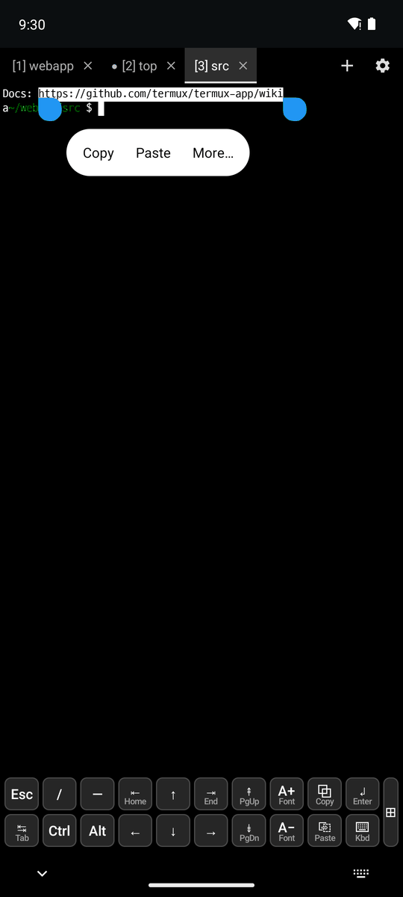
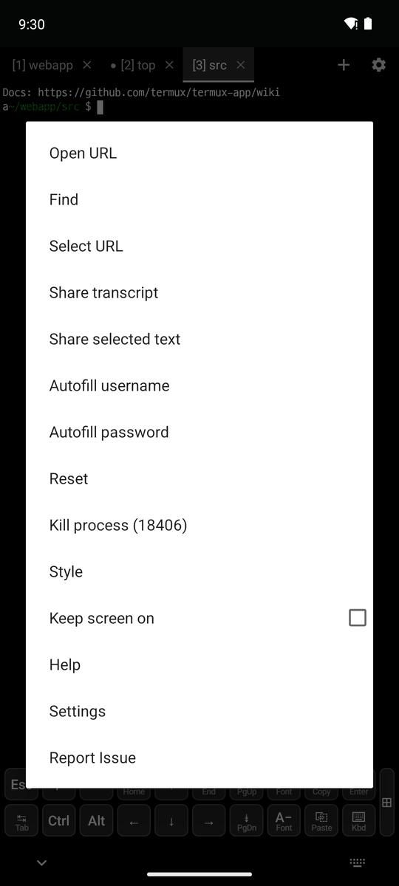

# 2. Display and fonts

[← Keyboard and input](1-keyboard.md) · [Contents](README.md) · [Next: Terminal tabs →](3-tabs.md)

## Fonts

Pick a font in **⚙ → Font** (or Settings → Terminal View → Font).

 

1. Tap a font to change the preview at the top. The preview is drawn the same way as the terminal, so it looks exactly like it will.
2. Under each name are the scripts it supports (EN 한 日 中 Кир ع ש ไทย Nerd), and for fonts that are downloaded, their size (↓ 6.2 MB).
3. Tap **Apply**. A downloaded font is fetched the first time it is applied and checked with SHA-256.

- The default font is **D2Coding ligature**.
- In the APK: D2Coding ligature, Cascadia Mono, DejaVu Sans Mono, JetBrains Mono, Fira Code, Hack, Source Code Pro
- Downloaded: D2Coding Nerd Font, NanumGothicCoding, Sarasa Mono K, Noto Sans Mono CJK KR

## Text size

- **Saved size**: change it with **Size…** in the font dialog (above, right) or in Settings → Terminal View → Font size.
- **Only the current tab** (not saved): the A+ / A− keys, pinch zoom, Ctrl+= / Ctrl+−

## Find in the output

Open it with **⚙ → Find**, long press → More → Find, or Ctrl+Shift+F.

- Matches are highlighted and counted (`4/4`). ▲/▼ go to the previous/next match.
- The scrollback is searched too. A search without capital letters ignores case.

## Opening URLs

 

1. Long press a URL. A long URL wrapped over several lines is selected in one go.
2. Tap **More…** → **Open URL** to open it in the browser. If the selection has several URLs, you can pick one.
