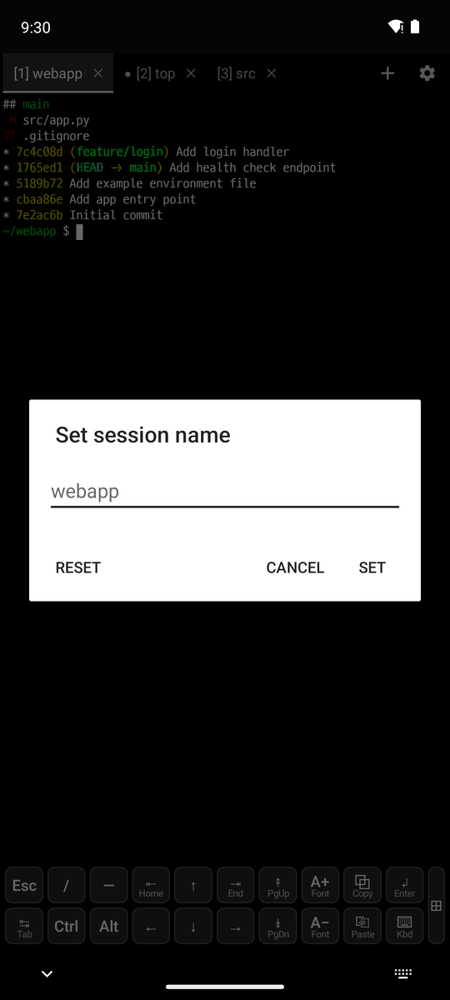

# 3. Terminal tabs

[← Display and fonts](2-display.md) · [Contents](README.md) · [Next: Snippets and clipboard →](4-snippets-clipboard.md)

 

The **session tab bar** above the terminal switches sessions (tap a tab), creates them (**+**) and closes them (**×**).

| Shown | Meaning |
|---|---|
| `[1] webapp` | Session number and title. A tab without a name shows the running program (`top`) or the working directory (`src`) |
| **●** | New output in a background tab |
| **🔔** | Bell in a background tab |

- **Rename**: tap the selected tab again (above, right). **Reset** clears the name and goes back to the automatic title.
- **Reorder, close**: long press a tab.
- **New tab (+)**: choose **Local shell**, **SSH**, **Web browser** or **Database**.
  - **Database** lists the saved database connections and **Manage connections…**, or opens the connection list if there are none ([Database](8-database.md)).
  - **SSH** is shown only when hosts are registered in the app, and lists them (● connected). **Manage SSH hosts…** at the bottom adds hosts.
  - Long press + for a named local shell. Ctrl+Shift+T opens a local shell right away.
- **Web tabs**: choosing a 🌐 tab shows an address bar and the page in place of the terminal.
  - A new tab shows quick links: the local port forwards of the connected SSH tabs, recent addresses and the manual.
  - ◀ ▶ ⟳ and ⋮ (Open in another app, Copy address, Quick links, Close tab) in the address bar. Text that is not an address is searched.
  - Back goes to the previous page, or to the terminal when there is none. Ctrl+L address bar, Ctrl+R reload, Ctrl+Shift+W close the tab.
- **Notifications**: when you are not looking at the app, a session that ends or rings the bell shows a notification. Tapping it opens that session.
- **⚙ menu**: at the right end of the tab bar. It has SSH, Snippets, Find, Clipboard history, Settings, Sessions list, Show/hide keyboard, Font, Edit termux.properties, Reload settings, Export/Import settings, Keyboard shortcuts and Language.

## Settings (`~/.termux/termux.properties`)

| Setting | Values |
|---|---|
| `terminal-tabs` | `top` (default), `bottom`, `off` |
| `terminal-tabs-show-close` | Whether tabs show × |
| `terminal-tab-auto-title` | `process`, `cwd`, `off` |
| `terminal-session-notifications` | `all`, `exit`, `bell`, `off` |
| `max-sessions` | Maximum number of sessions |

Tap **⚙ → Reload settings** after a change.
