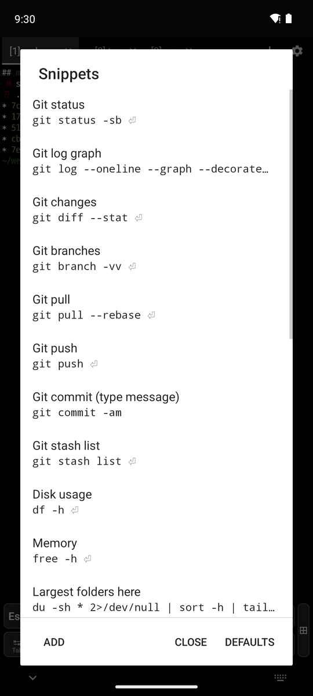
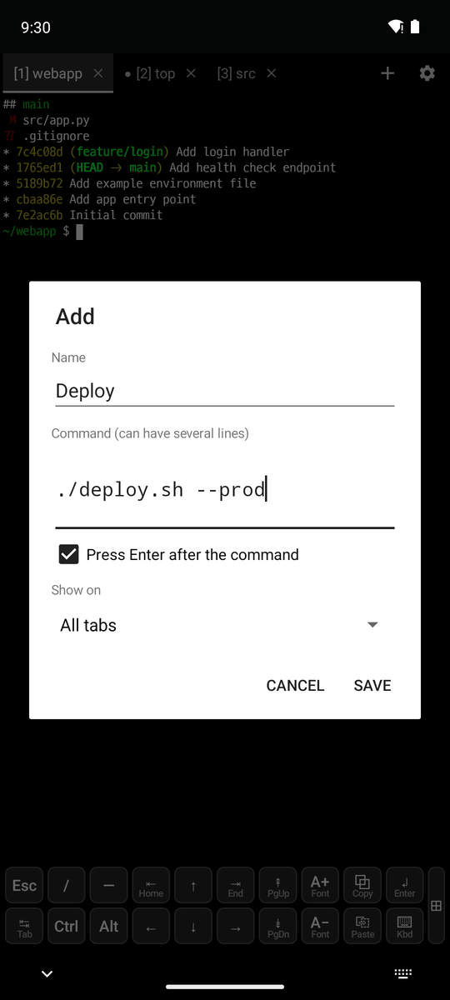
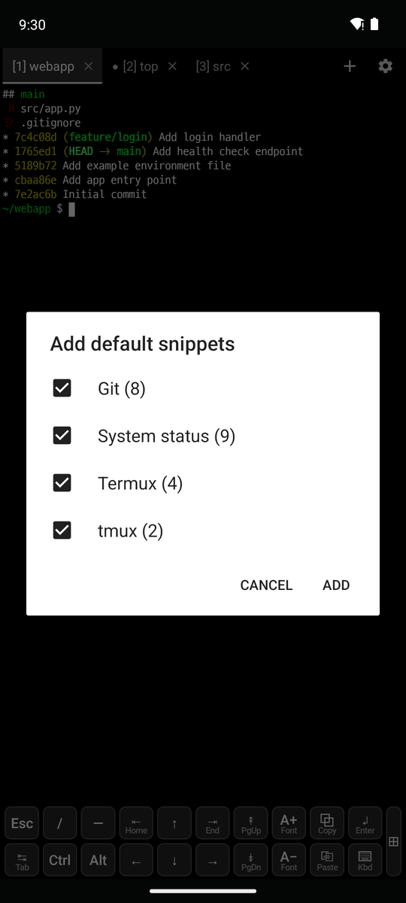
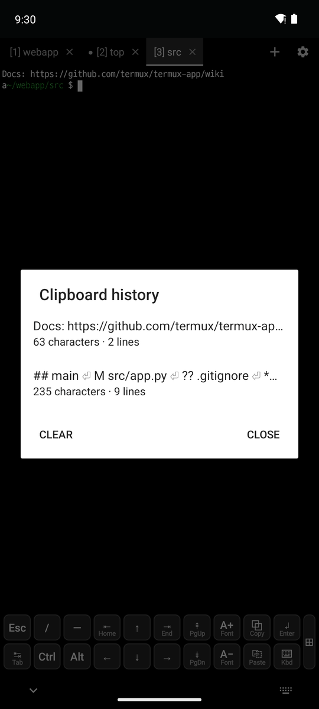

# 4. Snippets and clipboard

[← Terminal tabs](3-tabs.md) · [Contents](README.md) · [Next: SSH →](5-ssh.md)

## Snippets

Save the commands you use often, and tap one to type it into the current tab. Open them with **⚙ → Snippets**, Ctrl+Shift+S, or the `SNIPPETS` extra key.

  

- **Use**: tap a snippet to type it into the current tab. With ⏎ it also presses Enter.
- **Manage**: long press a snippet for Type into the tab, Edit, Move up/down and Delete.
- **Add** (middle): a name (the command is shown if empty), the command (can have several lines), **Press Enter after the command**, and **Show on** (all tabs, or the tabs of one SSH host).
- **Defaults** (right): pick the Git, System status, Packages (pkg) and tmux groups to add again. Commands you already have are skipped.
  - The first time you open the snippets, all the defaults are there.
  - Values a command needs, like a commit message, a commit hash or a user name, are shown as `<MESSAGE>`, `<HASH>`, `<USERNAME>` and asked for when tapped.
  - The Git commands that throw changes away without asking for a value are typed without Enter.
- **Values to ask for**: write `<NAME>` in a command to be asked for its value when tapping the snippet.
  - `<NAME=default>` fills in a default, like `<DIR=.>`. A name used several times is asked for once.
  - The dialog shows the command to send, then **Run** (with Enter) or **Type only**.
  - The last value of each name is filled in the next time.
- Saved in `~/.termux/snippets.json`, and included in the settings export.

## Clipboard history

Open it with **⚙ → Clipboard history**, Ctrl+Shift+H, **swiping up on the ⎘ Paste key**, or the `CLIPBOARD` extra key.

- Keeps the last 20 texts copied, in or outside the app, with their length in characters and lines.
- Tap one to paste it into the current tab, or long press it to paste, copy or delete it. **Clear** empties the list.
- It is kept only in memory and is gone when the app is closed.
