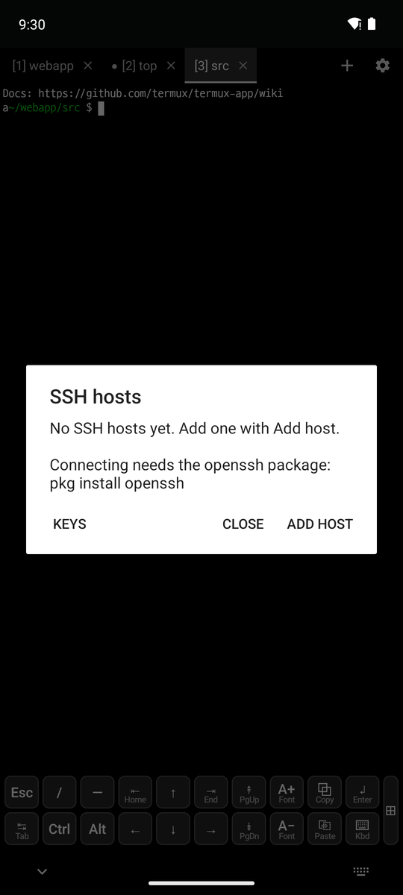
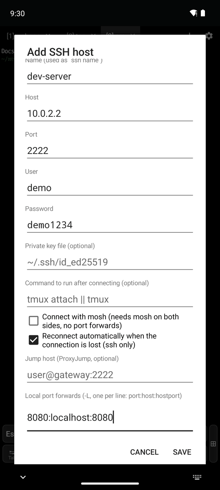
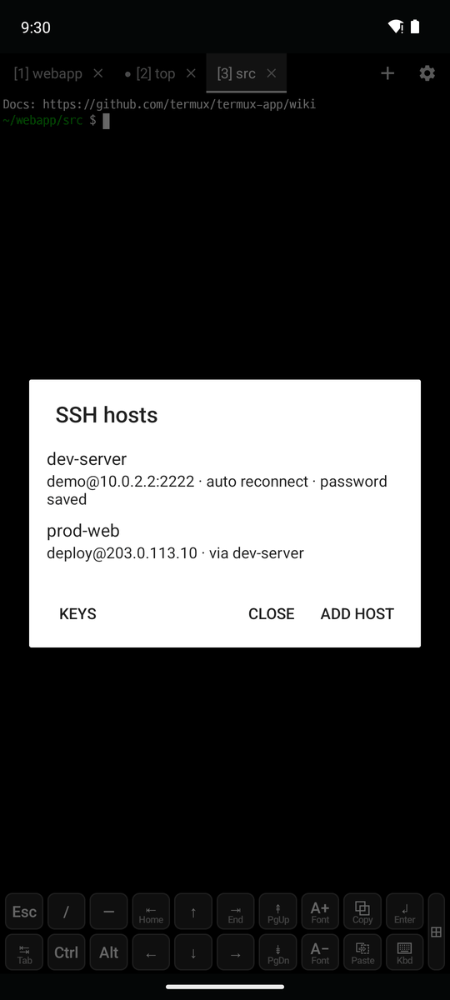
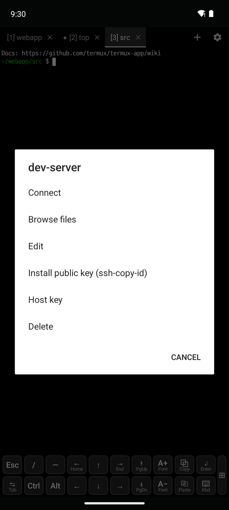
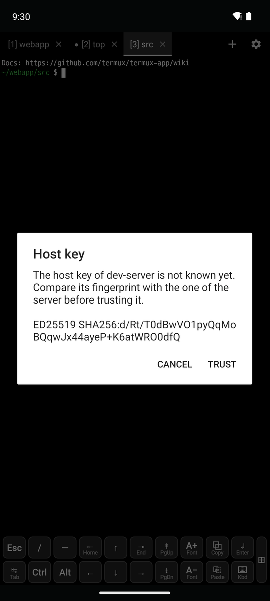
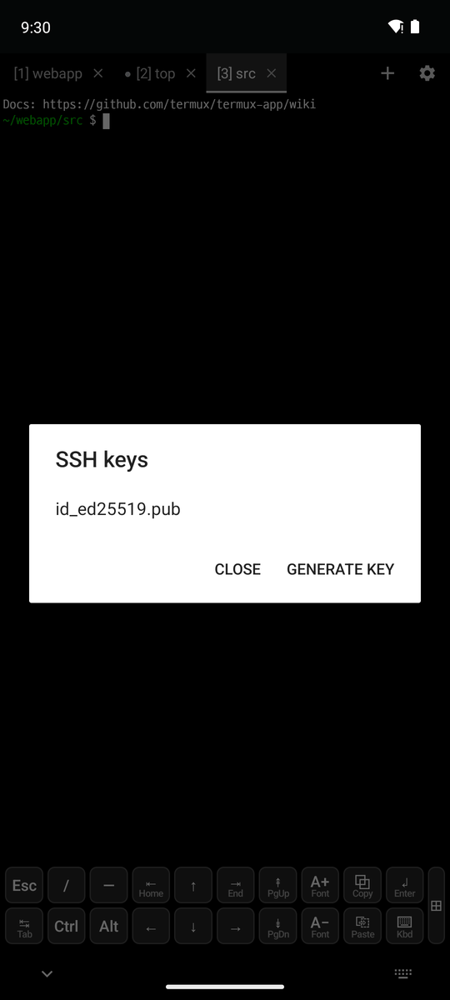
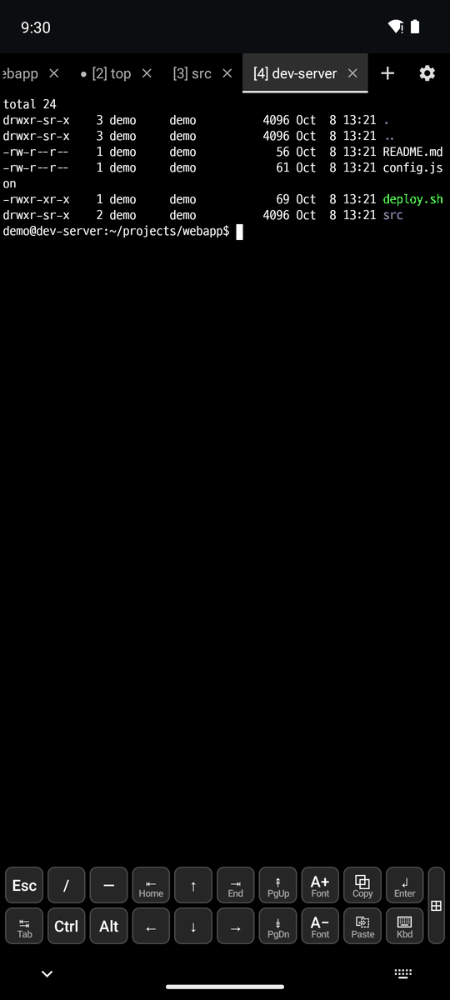
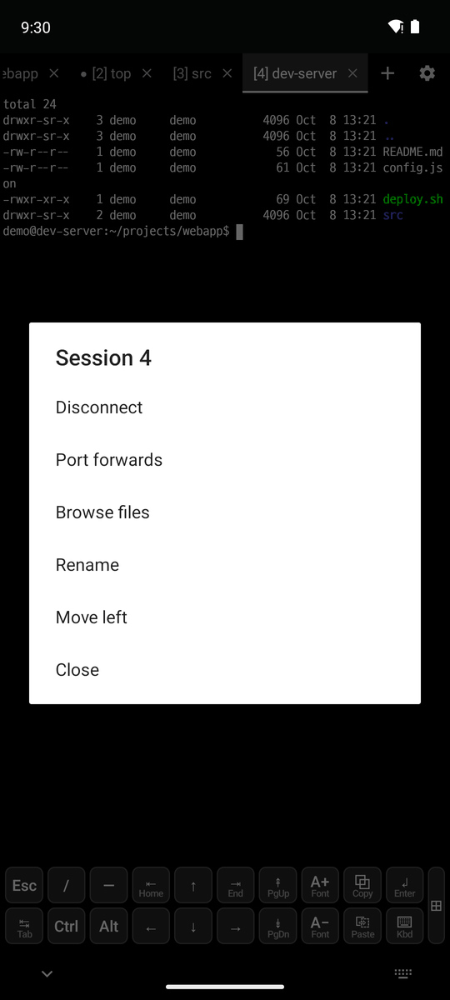
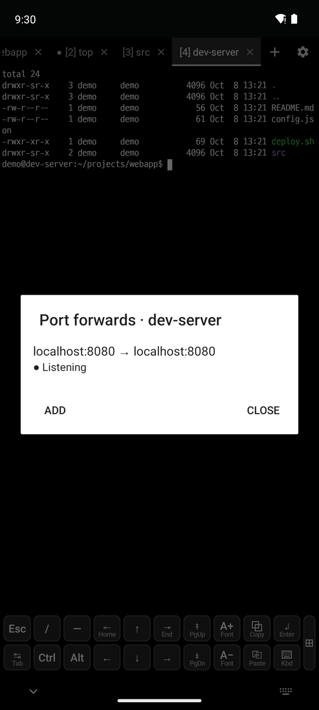

# 5. SSH

[← Snippets and clipboard](4-snippets-clipboard.md) · [Contents](README.md) · [Next: SFTP file browser →](6-sftp.md)

SSH needs the openssh package: `pkg install openssh`

## Adding a host

Tap **Add host** in **⚙ → SSH**.

  

| Field | Description |
|---|---|
| Name | Alias, also used as `ssh name` in the shell |
| Host, Port, User | The server to connect to |
| Password | Saved in the app, encrypted with the Android Keystore |
| Private key file | For example `~/.ssh/id_ed25519` |
| Command to run after connecting | For example `tmux attach \|\| tmux` |
| Connect with mosh | Needs `mosh-server` on the server |
| Reconnect automatically | Reconnects up to 5 times, 5 to 25 seconds apart, when the connection is lost |
| Jump host | ProxyJump: another host's name or `user@gateway:2222` |
| Local/remote port forwards, SOCKS port | `-L`, `-R`, `-D` |

- The list shows the address and a summary of the settings (auto reconnect, password saved, via a jump host).
- Only the line `Include termux_hosts` is added to `~/.ssh/config`, so `ssh dev-server` works in the shell too. Hosts you write in `~/.ssh/config` yourself are listed as well.

## Host menu and host keys

**Tap** a host to connect in a new tab, or **long press** it for the menu.

  

- **Connect / Browse files / Edit / Delete**
- **Install public key (ssh-copy-id)**: adds your public key on the server, so you can log in without a password from then on.
- **Host key** (middle): gets the server's key fingerprint (`ED25519 SHA256:…`) without logging in.
  - For an unknown key, compare it with the fingerprint from the server's administrator, then tap **Trust**.
  - A changed key shows a warning with the new and old fingerprints, and is replaced after one more confirmation.
- **Keys** (bottom left of the host list, right picture): the `~/.ssh/*.pub` keys. Tap one to copy the public key. **Generate key** makes an ed25519 key.

## SSH tabs

  

**Long press** an SSH tab for its menu.

- **Disconnect / Reconnect**: the tab stays after disconnecting, so you can reconnect in the same place.
- **Port forwards** (right): shows whether each forward's port is open (● Listening). Tap one to open a local port in the browser, and **Add** or stop forwards while connected.
- **Browse files**: opens the [SFTP file browser](6-sftp.md) over the tab's connection, without logging in again.
