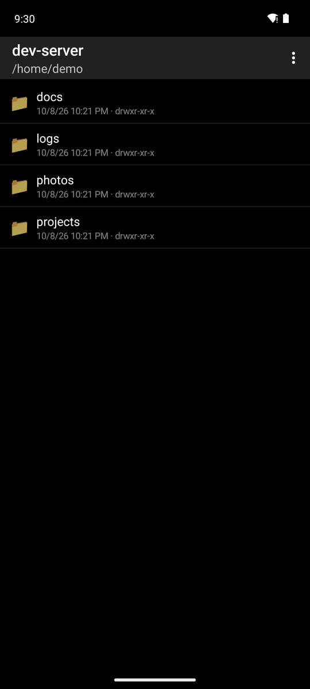
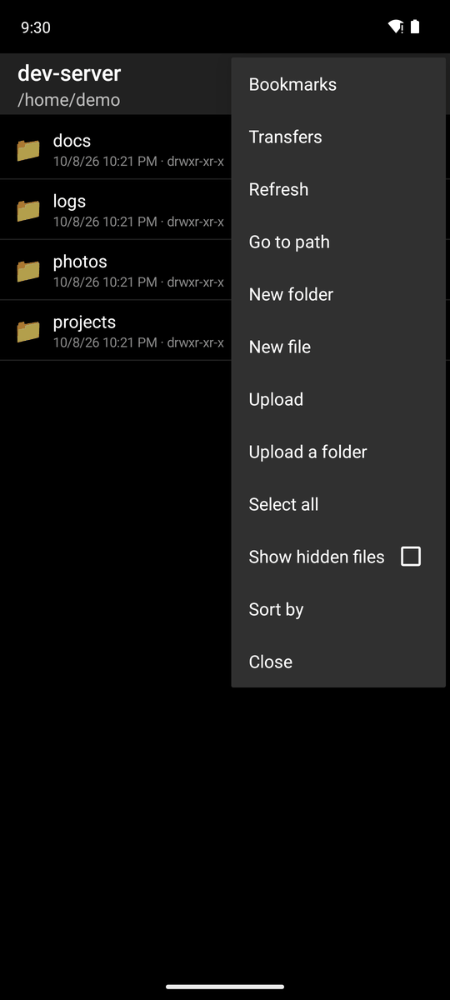
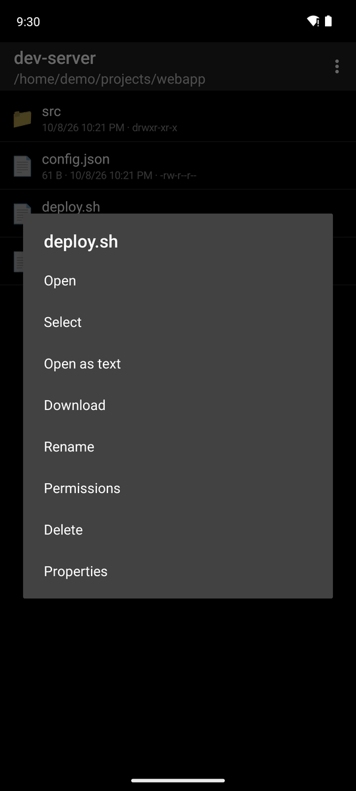
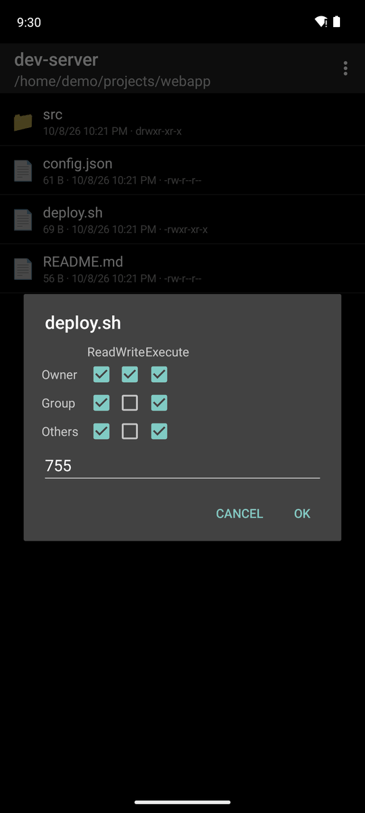
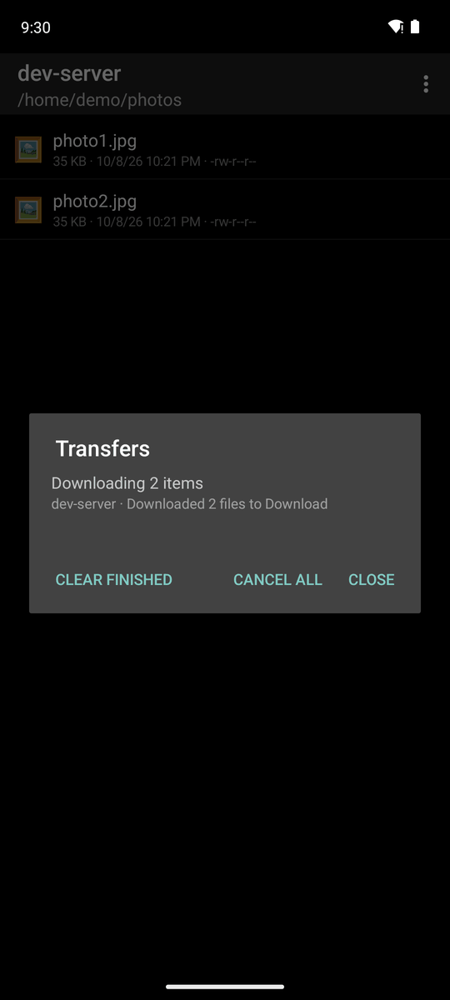
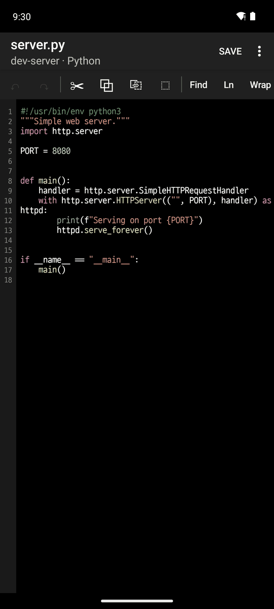
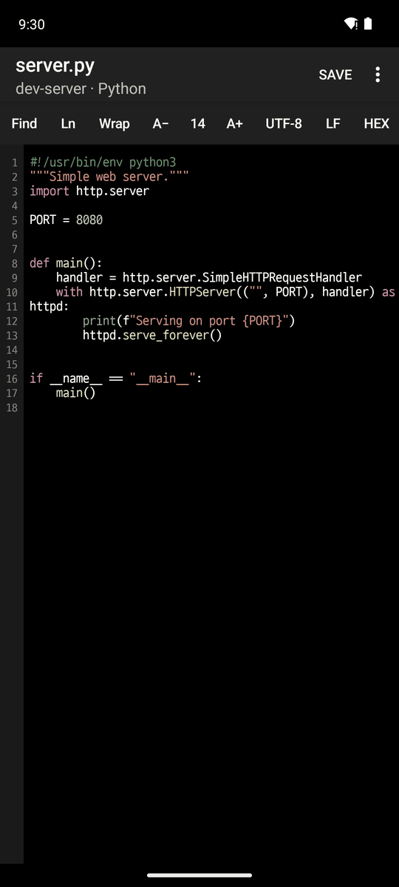
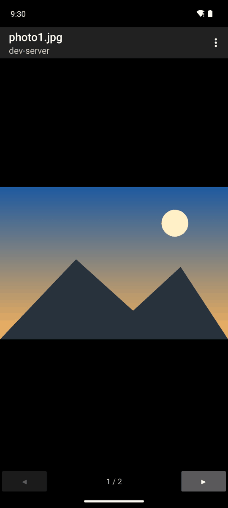

# 6. SFTP file browser

[← SSH](5-ssh.md) · [Contents](README.md) · [Next: Settings and language →](7-settings.md)

Open it by long pressing an SSH tab → **Browse files**, or from the host menu → **Browse files**.

## Browsing and file actions

  

- Tap a folder to open it, and go back to go up.
- **⋮ menu** (middle): Bookmarks (per host, home, `/`), Transfers, Refresh, Go to path, New folder/file, Upload, Upload a folder, Select all, Show hidden files, Sort by, Close
- **Long press a file** (right): Open, Select, Open as text, Download, Rename, Permissions, Delete, Properties

 

- **Permissions** (left): use the checkboxes or the octal value (`755`, setuid included), whichever is easier. They follow each other.
- **Selecting several** (right): start with **Select** in the file menu, then tap other files to add them. Download, delete or change the permissions of all of them from the ⋮ menu.

## Downloads, uploads and the transfer queue

- **Download**: saves into the `Download/` folder. Folders keep their structure.
- **Upload**: several files, or a whole folder. If a name already exists, you choose to replace or skip.
- Transfers run one at a time in the background and continue after you leave the file screen. The notification shows the progress, how many are left, and **Cancel all**.
- **⋮ → Transfers**: the transfers of all hosts. Stop one, see its error, or **Clear finished**.

## Text editor

Tap a text file to open it.

 

- **Syntax highlighting**: the language is found from the extension, the file name or the `#!` line (24 languages, including Shell, Python, JavaScript/TypeScript, JSON, Java, Kotlin, C/C++, Go, Rust, SQL, YAML, Markdown and Dockerfile). It is shown under the title.
- **Toolbar** (swipe left for the rest): Undo/Redo, Cut/Copy/Paste/Select all, Find, Go to line, Word wrap, font size A−/A+, encoding (UTF-8, UTF-16, CP949, EUC-JP and more, detected when opening), line endings (LF/CRLF), hex view
- **Save**: warns about a conflict if the file was changed elsewhere. It writes a temporary file and swaps it in, so the original stays if saving fails.

## Image viewer

- Pinch to zoom, use ◀ ▶ for the previous/next image in the folder, and download from the ⋮ menu.
