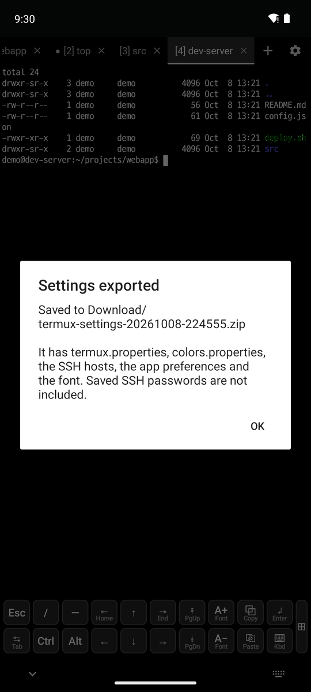
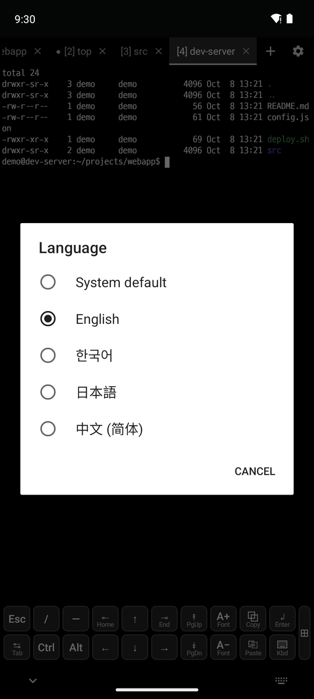
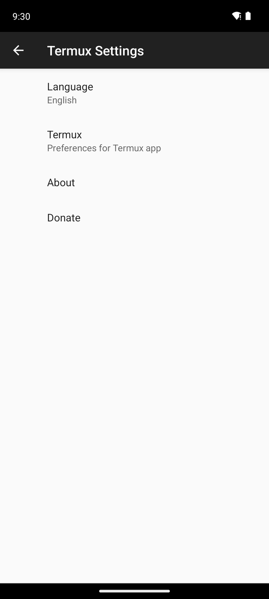
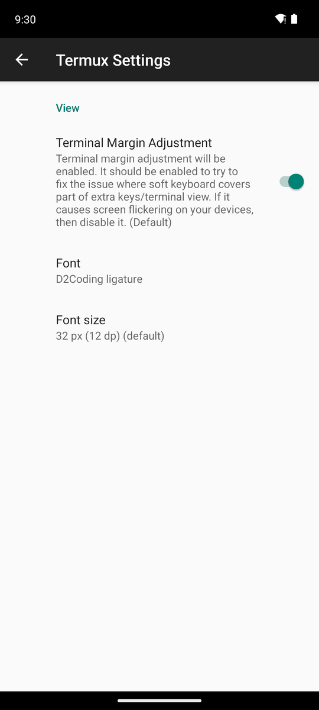

# 7. Settings and language

[← SFTP file browser](6-sftp.md) · [Contents](README.md) · [Next: Database →](8-database.md)

## Exporting and importing settings

- **⚙ → Export settings**: saves one file, `Download/termux-settings-*.zip`.
  - It has `termux.properties`, colors, SSH hosts, snippets, special key favorites, app preferences, the font, database connections and saved queries.
  - SSH and database passwords can't leave the device, so they are not included. Enter them again on the new device.
- **⚙ → Import settings**: pick the zip file with **Choose file**. The previous files are backed up in `~/.termux/backup/`.

## App language

 

- Choose System default, English, 한국어, 日本語 or 中文(简体) in **⚙ → Language** or Settings → **Language**.
- It changes right away, without restarting the app. System default follows the device language.

## Settings screen

**⚙ → Settings** → DevShell → **Terminal View** has the font and the saved font size. Other settings are in `~/.termux/termux.properties`, which **⚙ → Edit termux.properties** opens.

## Shell welcome

The local shell of a new tab starts with the DevShell welcome: links to the manual, new versions and issues, how to use `pkg`, and shortcuts. It is in the language of the app.

- The packages (bash, ssh, git and so on) come from the Termux repositories, so report package issues at the Termux link of the welcome. Report app issues at the issues of this repository.
- The welcome is `~/.termux/motd.sh`, which the app writes again for its language and version.
  - To change it yourself, delete its `# devshell-managed` line, and the app leaves it alone.
  - To hide it, run `touch ~/.hushlogin`.

## About and help

- **Settings → About** shows the links to the DevShell repository, releases, manual and issues, and app and device information.
- **Help** in the left drawer opens this manual.
