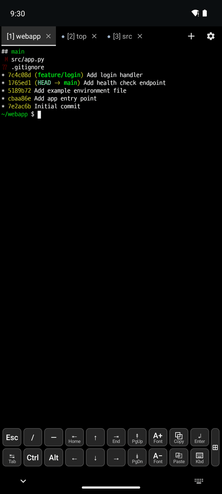

# DevShell user manual

[한국어](../ko/README.md)

The features of DevShell, with screenshots. DevShell is based on Termux and adds keyboard input, SSH, a file browser and more (repository: fharenheit/termux-app). Its packages come from the Termux repositories, so the `pkg` and `termux-*` commands and the `~/.termux` settings folder are the same as in Termux. For just the list of features, see [FEATURES.md](../../../../FEATURES.md) (Korean).

## Contents

1. [Keyboard and input](1-keyboard.md): extra keys, the special keys panel, hardware keyboards and shortcuts
2. [Display and fonts](2-display.md): fonts, text size, find in the output, opening URLs
3. [Terminal tabs](3-tabs.md): the session tab bar, new output and bell marks, renaming, the ⚙ menu
4. [Snippets and clipboard](4-snippets-clipboard.md): snippets, default snippets, clipboard history
5. [SSH](5-ssh.md): adding hosts, host keys, keys, SSH tabs, port forwards
6. [SFTP file browser](6-sftp.md): file actions, permissions, the transfer queue, the text editor, the image viewer
7. [Settings and language](7-settings.md): exporting/importing settings, the app language, the shell welcome, about and help

## Getting started

- **⚙** is the menu at the right end of the terminal tab bar. Most features of this fork open from there.
- "Long press" means pressing and holding the terminal or a tab.
- Run `pkg install openssh` in the terminal to use SSH and SFTP.

The screenshots are of v0.118.3-ko.23 on an Android 14 emulator (Pixel 6). [tools/README.md](../tools/README.md) (Korean) describes how to take them again.
