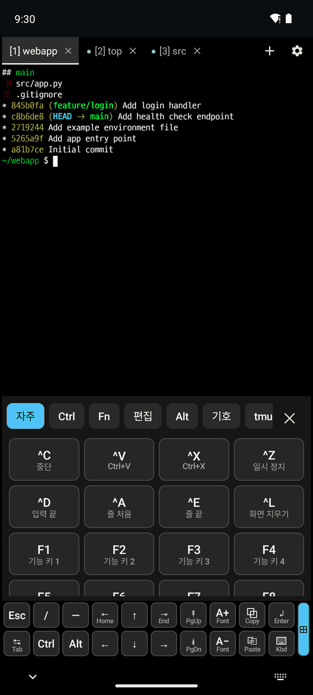
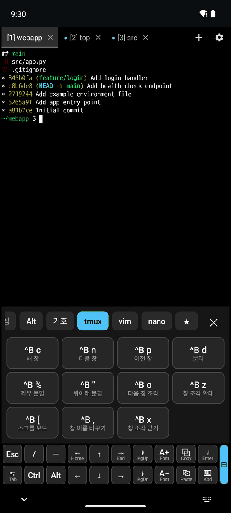
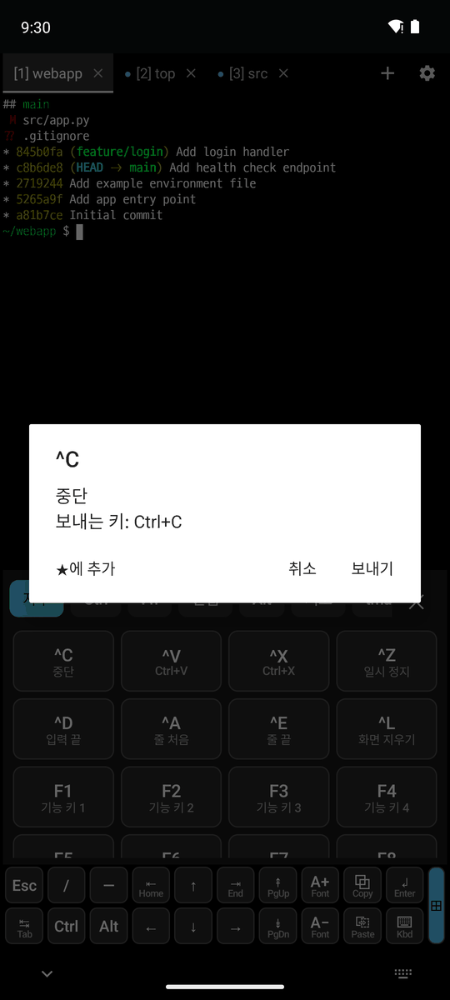
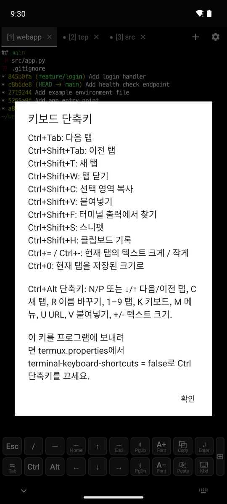

# 1. 키보드와 입력

[← 목차](README.md) · [다음: 화면과 글꼴 →](2-display.md)

## 하단 키

터미널 아래의 두 줄 키입니다. 키캡 모양으로 그려지고, 키 안에 아이콘과 작은 이름이 붙어 있습니다.

| 키 | 동작 |
|---|---|
| **↲ Enter** | Enter |
| **⌨ Kbd** | 화면 키보드 표시/숨기기 |
| **A+ / A−** | 지금 탭의 글자 크기만 키우기/줄이기(저장되지 않음) |
| **⧉ Copy** | 선택한 글자 복사. **위로 밀면** 화면 전체 복사 |
| **⎘ Paste** | 붙여넣기. **위로 밀면** [클립보드 기록](4-snippets-clipboard.md#클립보드-기록) |
| **Ctrl / Alt** | 누르면 켜지고(파란색) 다음 키와 함께 전송 |
| **⊞** | [특수 키 패널](#특수-키-패널) 열기 |

- 예전 모양으로 돌아가려면 `~/.termux/termux.properties`에 `extra-keys-style = default`를 넣습니다.
- 배치를 직접 정할 때 `SNIPPETS`, `CLIPBOARD`, `COPY_SCREEN`, `SPECIAL_KEYS` 키를 쓸 수 있고, `{key: 'X', rows: 2, width: 0.5}`처럼 두 줄 높이나 좁은 키를 만들 수 있습니다.

## 특수 키 패널

하단 키 오른쪽 끝의 **⊞**를 누르면 열립니다. 10개 탭(자주, Ctrl, Fn, 편집, Alt, 기호, tmux, vim, nano, ★)으로 나뉘고, 모든 키 아래에 설명이 붙어 있습니다.

  

1. 탭을 좌우로 밀어 원하는 묶음을 고릅니다(가운데: tmux 탭).
2. 키를 누르면 보내고 패널을 유지해 연속으로 누를 수 있습니다. ✕ 또는 ⊞ 키를 다시 누르면 닫힙니다. 하단 키에서 켜 둔 Ctrl/Alt가 함께 전송됩니다.
3. 키를 **길게 누르면** 보내는 키의 설명이 나옵니다(오른쪽). **★에 추가**를 누르면 ★ 탭에 모입니다.

## 하드웨어 키보드

- 블루투스/USB 키보드로 한글을 입력할 수 있고, 조합 중인 글자가 커서 위치에 표시됩니다.
- 탭을 바꾸면 조합 중이던 글자는 버려집니다(다른 탭에 섞여 들어가지 않음).
- 단축키 목록은 **⚙ → 키보드 단축키**에서 볼 수 있습니다.

| 단축키 | 동작 |
|---|---|
| Ctrl+Tab / Ctrl+Shift+Tab | 다음/이전 탭 |
| Ctrl+Shift+T / Ctrl+Shift+W | 새 탭 / 탭 닫기 |
| Ctrl+Shift+C / Ctrl+Shift+V | 복사 / 붙여넣기 |
| Ctrl+Shift+F | 출력에서 찾기 |
| Ctrl+Shift+S | 스니펫 |
| Ctrl+Shift+H | 클립보드 기록 |
| Ctrl+= / Ctrl+− / Ctrl+0 | 지금 탭 글자 크기 키우기/줄이기/되돌리기 |

단축키를 끄려면 `terminal-keyboard-shortcuts = false`로 설정합니다.
