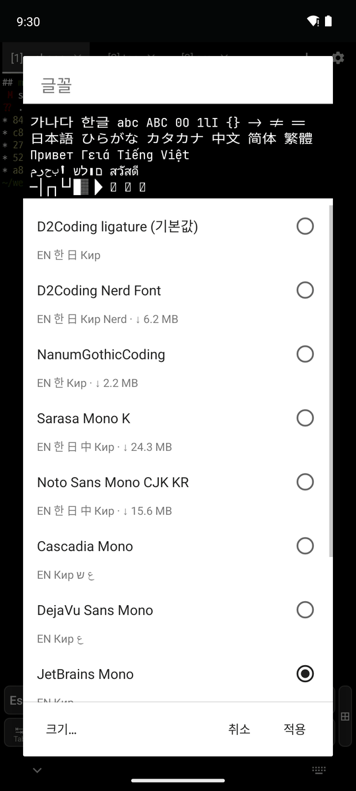
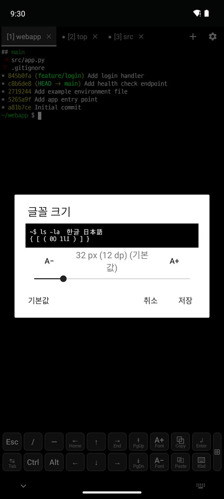
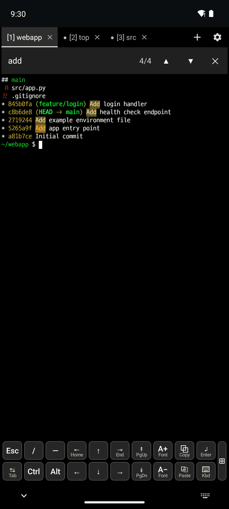
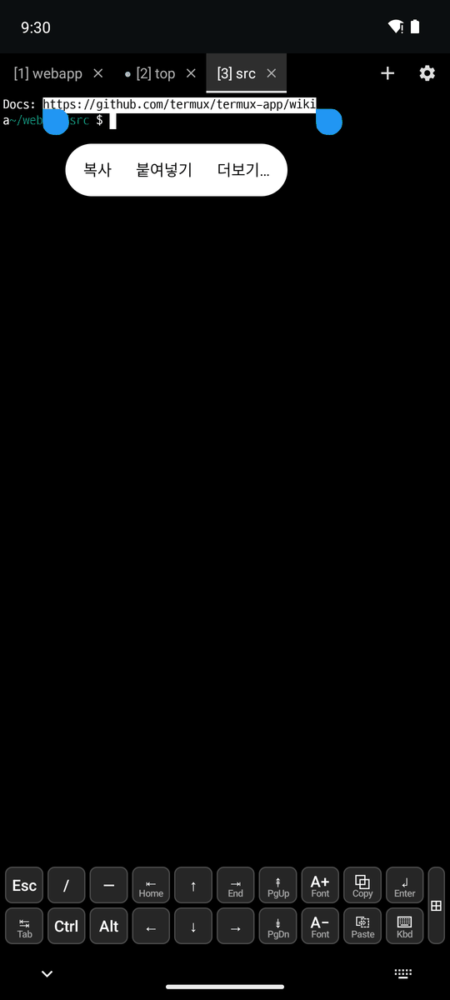
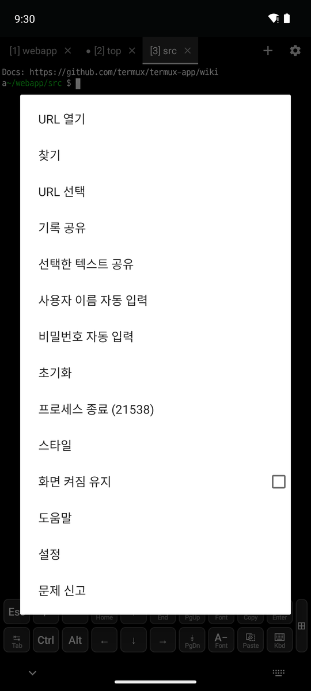

# 2. 화면과 글꼴

[← 키보드와 입력](1-keyboard.md) · [목차](README.md) · [다음: 터미널 탭 →](3-tabs.md)

## 글꼴

**⚙ → 글꼴**(또는 설정 → Terminal View → 글꼴)에서 고릅니다.

 

1. 목록에서 글꼴을 누르면 위쪽 미리보기가 바뀝니다. 미리보기는 터미널과 같은 방식으로 그려서 실제 모습 그대로입니다.
2. 글꼴 이름 아래에 지원하는 문자(EN 한 日 中 Кир ع ש ไทย Nerd)와, 내려받아야 하는 글꼴은 크기(↓ 6.2 MB)가 표시됩니다.
3. **적용**을 누릅니다. 내려받는 글꼴은 처음 적용할 때 받고 SHA-256을 확인합니다.

- 기본 글꼴은 **D2Coding ligature**입니다.
- APK에 들어 있음: D2Coding ligature, Cascadia Mono, DejaVu Sans Mono, JetBrains Mono, Fira Code, Hack, Source Code Pro
- 내려받음: D2Coding Nerd Font, NanumGothicCoding, Sarasa Mono K, Noto Sans Mono CJK KR

## 글자 크기

- **저장되는 크기**: 글꼴 창의 **크기…**(위 오른쪽) 또는 설정 → Terminal View → 글꼴 크기에서 바꿉니다.
- **지금 탭에서만 바꾸기**(저장하지 않음): A+ / A− 키, 두 손가락 확대/축소, Ctrl+= / Ctrl+−

## 출력에서 찾기

**⚙ → 찾기**, 길게 누르기 → 더보기 → 찾기, 또는 Ctrl+Shift+F로 엽니다.

- 일치한 곳이 강조되고, 개수(`4/4`)가 표시됩니다. ▲/▼로 이전/다음으로 이동합니다.
- 스크롤된 기록까지 검색합니다. 검색어에 대문자가 없으면 대소문자를 무시합니다.

## URL 열기

 

1. URL을 길게 누릅니다. 여러 줄로 넘어간 긴 URL도 한 번에 선택됩니다.
2. **더보기…** → **URL 열기**를 누르면 브라우저에서 열립니다. 선택에 URL이 여러 개면 고를 수 있습니다.
