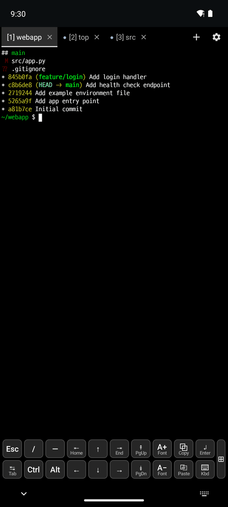
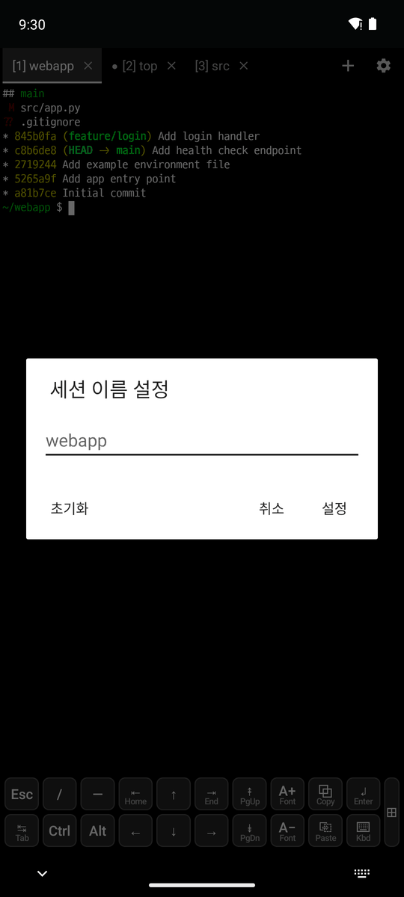

# 3. 터미널 탭

[← 화면과 글꼴](2-display.md) · [목차](README.md) · [다음: 스니펫과 클립보드 →](4-snippets-clipboard.md)

 

터미널 위의 **세션 탭 바**에서 세션을 전환하고(탭 누르기), 새로 만들고(**+**), 닫습니다(**×**).

| 표시 | 뜻 |
|---|---|
| `[1] webapp` | 세션 번호와 제목. 이름이 없으면 실행 중인 프로그램(`top`)이나 작업 폴더(`src`)가 표시됩니다 |
| **●** | 백그라운드 탭에 새 출력 |
| **🔔** | 백그라운드 탭에서 벨이 울림 |

- **이름 바꾸기**: 선택된 탭을 다시 누릅니다(위 오른쪽). **초기화**를 누르면 이름이 지워지고 자동 제목으로 돌아갑니다.
- **순서 바꾸기, 닫기**: 탭을 길게 누릅니다.
- **새 탭(+)**: **로컬 셸**, **SSH**, **웹 브라우저**, **데이터베이스** 중에서 고릅니다.
  - **데이터베이스**는 등록한 DB 접속 목록과 **DB 접속 관리…**를 보여 주고, 접속이 없으면 접속 관리 창을 엽니다([데이터베이스](8-database.md)).
  - **SSH**는 앱에 등록한 호스트가 있을 때만 보이고, 누르면 호스트 목록이 나옵니다(● 접속 중). 맨 아래 **SSH 호스트 관리…**로 호스트를 추가합니다.
  - +를 길게 누르면 이름을 붙인 로컬 셸을 엽니다. Ctrl+Shift+T는 바로 로컬 셸을 엽니다.
- **웹 탭**: 🌐 탭을 고르면 터미널 대신 주소 줄과 웹 페이지가 보입니다.
  - 새 탭에는 빠른 주소가 나옵니다: 접속 중인 SSH 탭의 로컬 포트 포워딩, 최근 주소, 사용 설명서.
  - 주소 줄의 ◀ ▶ ⟳와 ⋮(다른 앱으로 열기, 주소 복사, 빠른 주소, 탭 닫기). 주소 대신 검색어를 넣으면 검색합니다.
  - 뒤로 가기 버튼은 이전 페이지로, 더 없으면 터미널로 돌아갑니다. Ctrl+L 주소 줄, Ctrl+R 새로 고침, Ctrl+Shift+W 탭 닫기.
- **알림**: 앱을 보고 있지 않을 때 세션이 끝나거나 벨이 울리면 알림이 옵니다. 누르면 그 세션이 열립니다.
- **⚙ 메뉴**: 탭 바 오른쪽 끝입니다. SSH, 스니펫, 찾기, 클립보드 기록, 설정, 세션 목록, 키보드 표시/숨기기, 글꼴, `termux.properties` 편집, 설정 다시 불러오기, 설정 내보내기/가져오기, 키보드 단축키, 언어가 있습니다.

## 설정(`~/.termux/termux.properties`)

| 설정 | 값 |
|---|---|
| `terminal-tabs` | `top`(기본), `bottom`, `off` |
| `terminal-tabs-show-close` | 탭의 × 표시 여부 |
| `terminal-tab-auto-title` | `process`, `cwd`, `off` |
| `terminal-session-notifications` | `all`, `exit`, `bell`, `off` |
| `max-sessions` | 최대 세션 수 |

바꾼 뒤 **⚙ → 설정 다시 불러오기**를 누릅니다.
