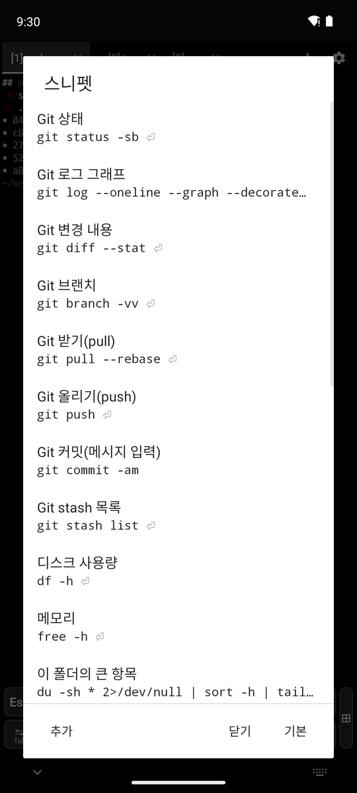
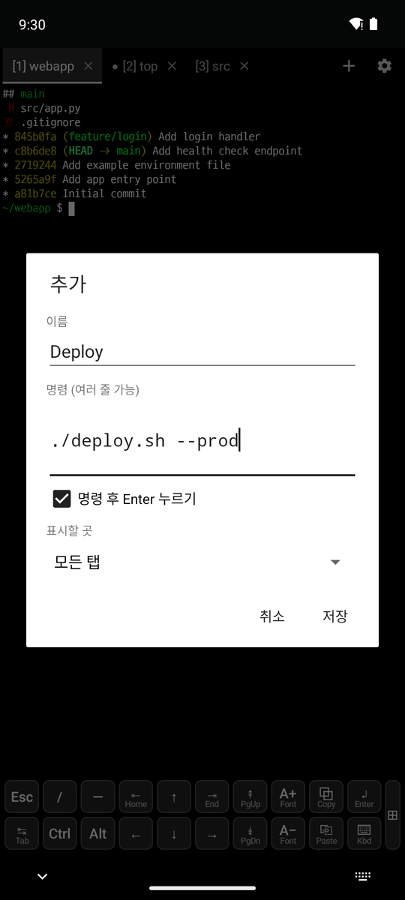
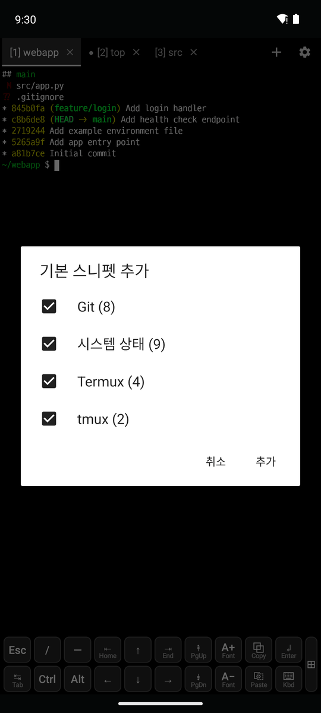
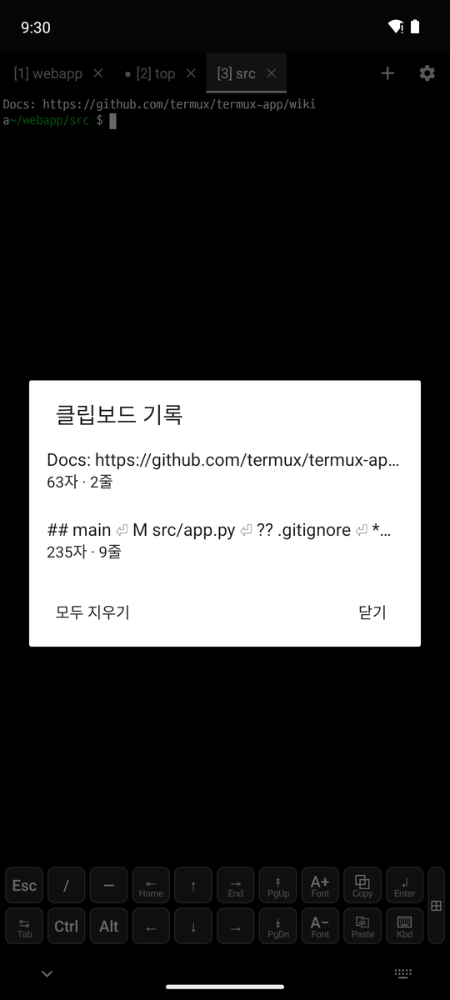

# 4. 스니펫과 클립보드

[← 터미널 탭](3-tabs.md) · [목차](README.md) · [다음: SSH →](5-ssh.md)

## 스니펫

자주 쓰는 명령을 저장해 두고, 누르면 지금 탭에 입력합니다. **⚙ → 스니펫**, Ctrl+Shift+S, 또는 `SNIPPETS` 하단 키로 엽니다.

  

- **사용**: 스니펫을 누르면 지금 탭에 입력됩니다. ⏎ 표시가 있으면 Enter까지 눌러 실행합니다.
- **관리**: 스니펫을 길게 누르면 탭에 입력, 편집, 위/아래로 이동, 삭제를 고릅니다.
- **추가**(가운데): 이름(비우면 명령이 표시됨), 명령(여러 줄 가능), **명령 후 Enter 누르기**, **표시할 곳**(모든 탭 또는 특정 SSH 호스트 탭)을 정합니다.
- **기본**(오른쪽): Git, 시스템 상태, 패키지(pkg), tmux 묶음을 골라 다시 추가합니다. 이미 있는 명령은 건너뜁니다.
  - 처음 열면 기본 스니펫이 모두 들어 있습니다.
  - 커밋 메시지, 커밋 해시, 사용자 이름처럼 필요한 값은 `<MESSAGE>`, `<HASH>`, `<USERNAME>` 등으로 표시되어 누를 때 입력받습니다.
  - 입력할 값이 없는 Git 강제 되돌리기/강제 pull은 Enter 없이 입력만 합니다.
- **입력받는 값**: 명령에 `<NAME>`을 쓰면 누를 때 값을 묻는 창이 열립니다.
  - `<NAME=기본값>`은 기본값을 채워 둡니다(예: `<DIR=.>`). 같은 이름은 한 번만 묻습니다.
  - 창에 보낼 명령이 미리 보이고, **실행**(Enter까지) 또는 **입력만**을 고릅니다.
  - 이름별로 마지막에 쓴 값을 기억해서 다음에 채워 둡니다.
- `~/.termux/snippets.json`에 저장되고 설정 내보내기에 포함됩니다.

## 클립보드 기록

**⚙ → 클립보드 기록**, Ctrl+Shift+H, **⎘ Paste 키를 위로 밀기**, 또는 `CLIPBOARD` 하단 키로 엽니다.

- 최근 복사한 글 20개를 보관합니다(앱 안팎에서 복사한 것 모두). 글자 수와 줄 수가 표시됩니다.
- 누르면 지금 탭에 붙여넣고, 길게 누르면 붙여넣기/복사/삭제를 고릅니다. **모두 지우기**로 비웁니다.
- 메모리에만 보관해서 앱을 닫으면 사라집니다.
