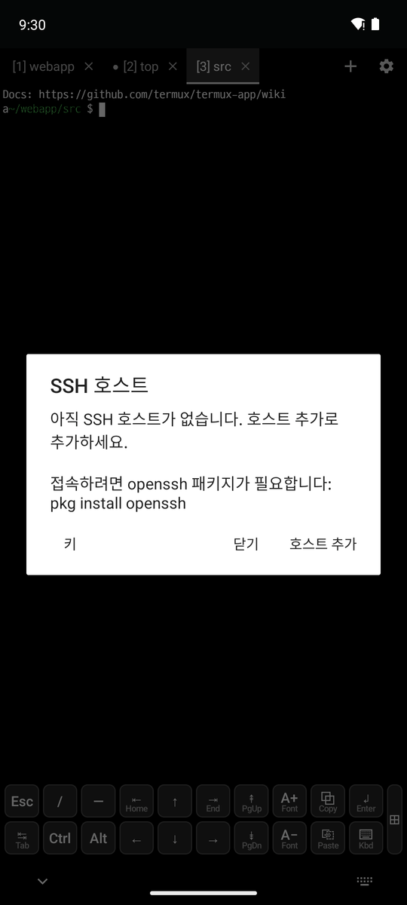
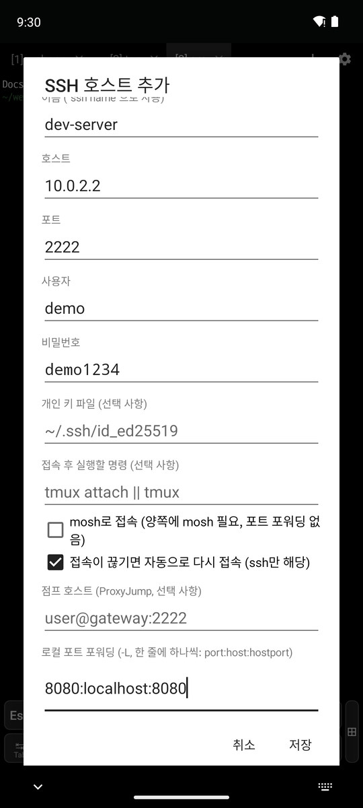
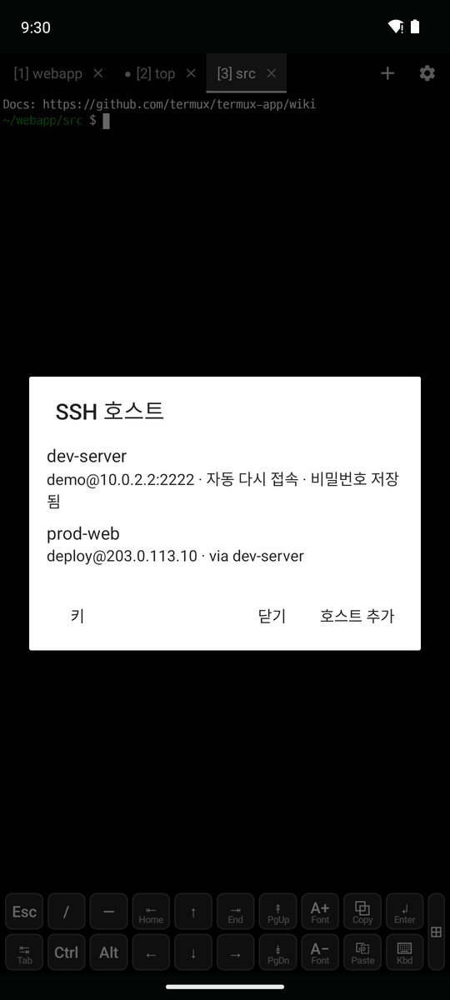
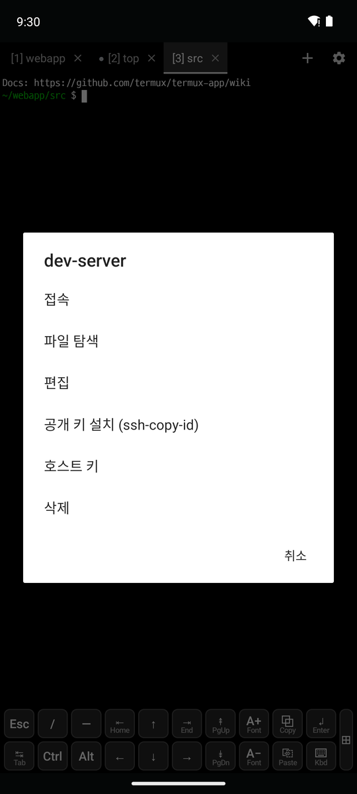
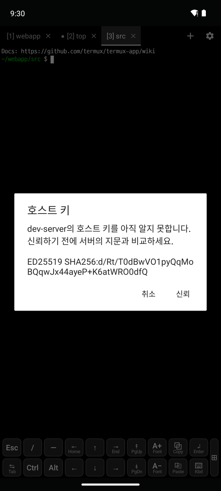
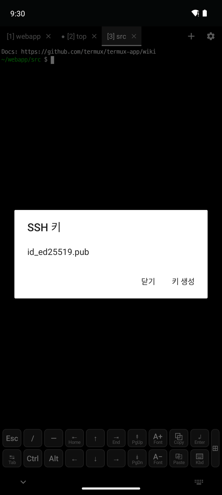
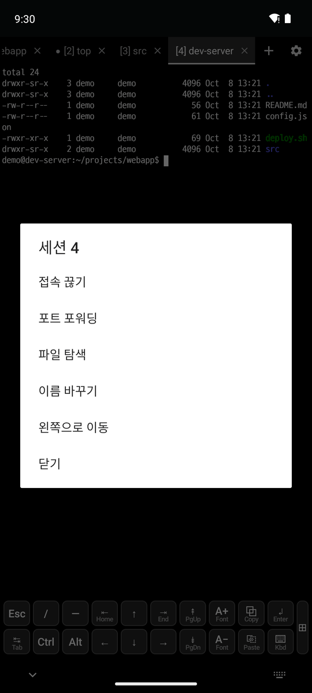
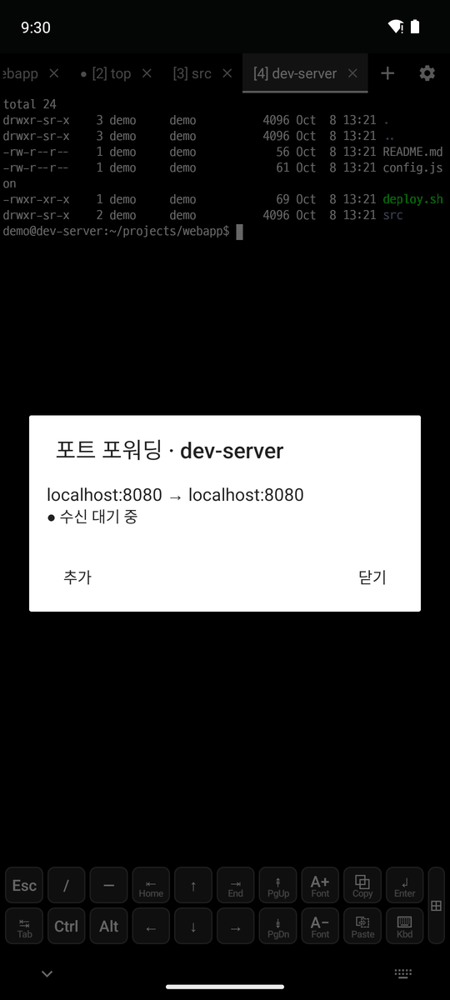

# 5. SSH

[← 스니펫과 클립보드](4-snippets-clipboard.md) · [목차](README.md) · [다음: SFTP 파일 탐색 →](6-sftp.md)

SSH 접속에는 openssh 패키지가 필요합니다: `pkg install openssh`

## 호스트 등록

**⚙ → SSH**에서 **호스트 추가**를 누릅니다.

  

| 항목 | 설명 |
|---|---|
| 이름 | 셸에서 `ssh 이름`으로도 쓰는 별칭 |
| 호스트, 포트, 사용자 | 접속할 서버 |
| 비밀번호 | Android Keystore로 암호화해서 앱 안에 저장 |
| 개인 키 파일 | 예: `~/.ssh/id_ed25519` |
| 접속 후 실행할 명령 | 예: `tmux attach \|\| tmux` |
| mosh로 접속 | 서버에 `mosh-server`가 있어야 합니다 |
| 자동으로 다시 접속 | 끊기면 5~25초 간격으로 최대 5번 다시 접속 |
| 점프 호스트 | ProxyJump. 다른 호스트 이름이나 `user@gateway:2222` |
| 로컬/원격 포트 포워딩, SOCKS 포트 | `-L`, `-R`, `-D` |

- 목록에는 접속 정보와 설정 요약(자동 다시 접속, 비밀번호 저장됨, via 점프 호스트)이 표시됩니다.
- `~/.ssh/config`에는 `Include termux_hosts` 한 줄만 넣으므로 셸에서도 `ssh dev-server`로 접속할 수 있습니다. `~/.ssh/config`에 직접 적은 호스트도 목록에 나옵니다.

## 호스트 메뉴와 호스트 키

호스트를 **누르면** 새 탭에서 접속하고, **길게 누르면** 메뉴가 나옵니다.

  

- **접속 / 파일 탐색 / 편집 / 삭제**
- **공개 키 설치(ssh-copy-id)**: 내 공개 키를 서버에 등록해서 이후 비밀번호 없이 접속합니다.
- **호스트 키**(가운데): 로그인하지 않고 서버 키 지문(`ED25519 SHA256:…`)을 받아 보여 줍니다.
  - 모르는 키는 서버 관리자에게 받은 지문과 비교한 뒤 **신뢰**를 누릅니다.
  - 바뀐 키는 경고와 함께 새/기존 지문을 보여 주고, 한 번 더 확인한 뒤 교체합니다.
- **키**(호스트 목록의 왼쪽 아래 버튼, 오른쪽 그림): `~/.ssh/*.pub` 목록입니다. 누르면 공개 키가 복사됩니다. **키 생성**으로 ed25519 키를 만듭니다.

## SSH 탭

  

SSH 탭을 **길게 누르면** 메뉴가 나옵니다.

- **접속 끊기 / 다시 접속**: 끊어도 탭이 남아 같은 위치에서 다시 접속할 수 있습니다.
- **포트 포워딩**(오른쪽): 포워딩마다 포트가 열려 있는지(● 수신 대기 중) 표시합니다. 누르면 로컬 포트를 브라우저로 열고, 접속 중에 **추가**하거나 중지할 수 있습니다.
- **파일 탐색**: 탭의 연결을 공유해 다시 로그인하지 않고 [SFTP 파일 탐색](6-sftp.md)을 엽니다.
