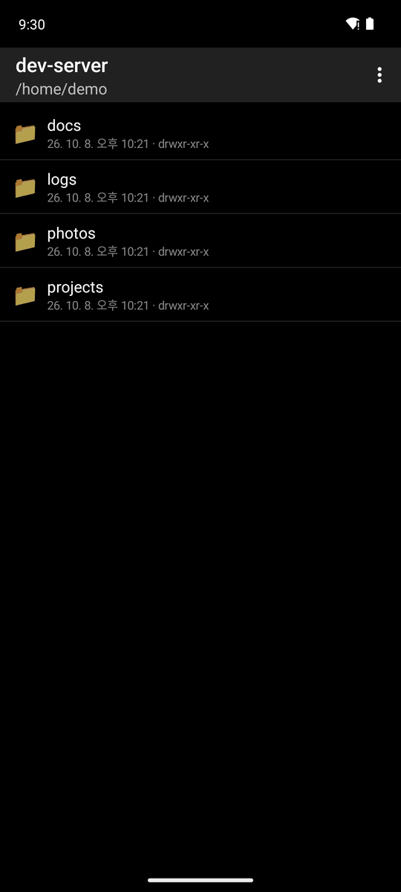
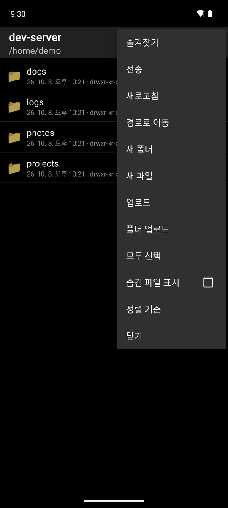
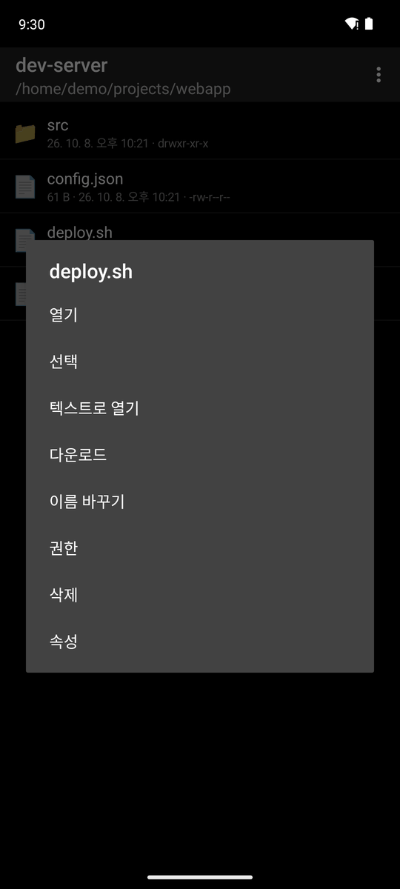
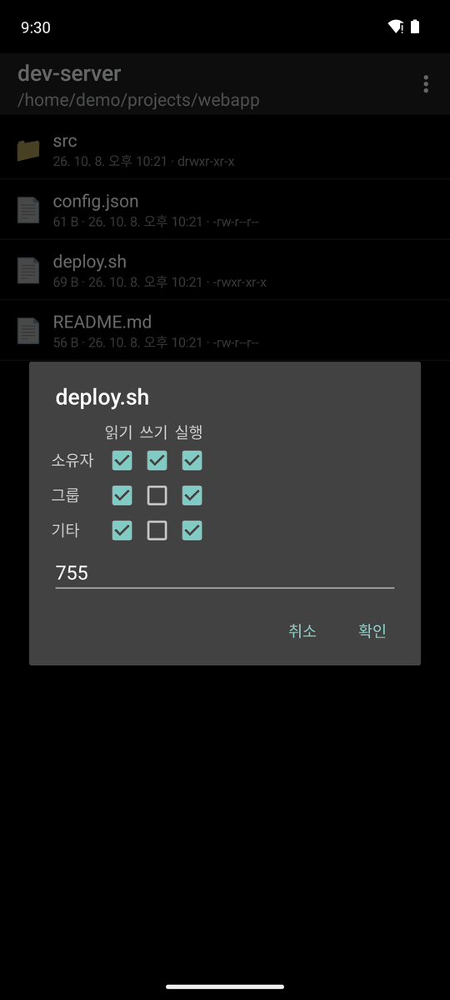
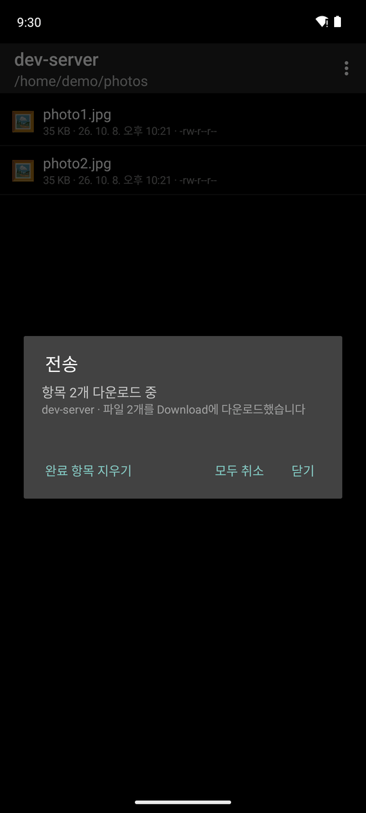
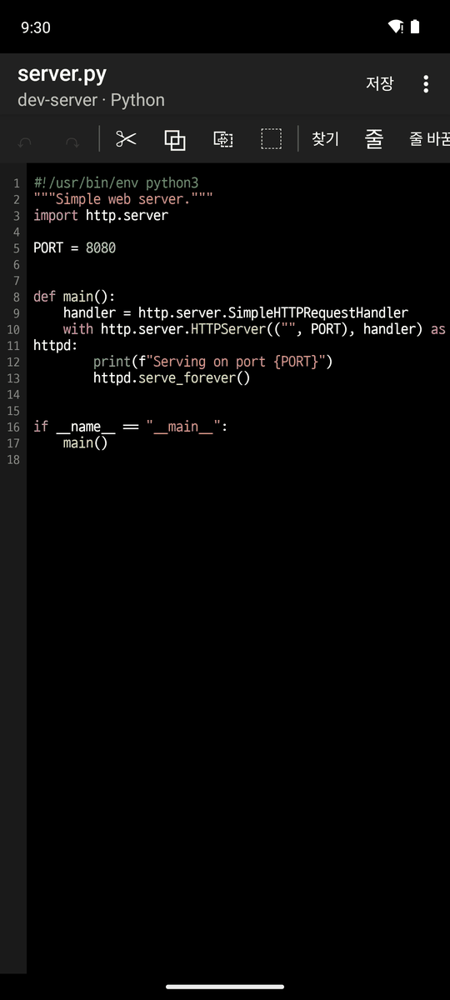
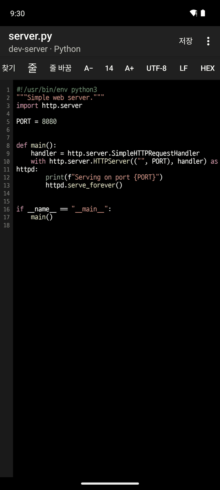
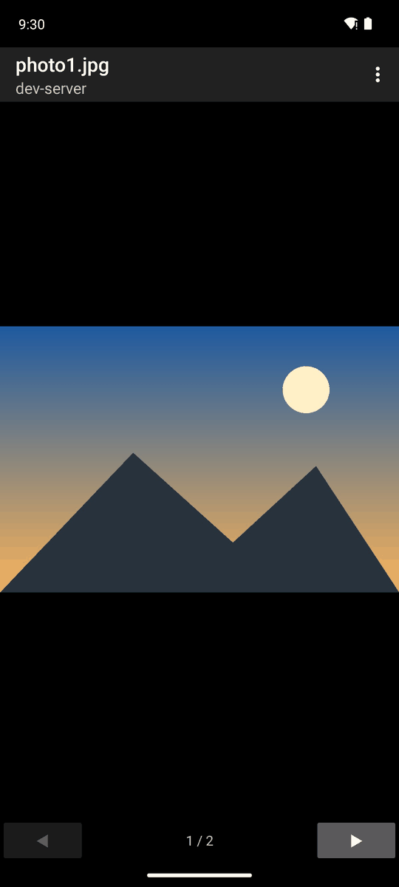

# 6. SFTP 파일 탐색

[← SSH](5-ssh.md) · [목차](README.md) · [다음: 설정과 언어 →](7-settings.md)

SSH 탭을 길게 누르기 → **파일 탐색**, 또는 호스트 메뉴 → **파일 탐색**으로 엽니다.

## 터미널의 현재 폴더에서 열기

일반 Linux SSH 서버에서는 별도 설정 없이 **파일 탐색**을 여는 시점에 해당 탭의 로그인 셸 작업 폴더를 조회합니다. 입력 중인 문장이나 실행 중인 프로그램에 명령을 보내지 않으며, 서버의 설정 파일도 수정하지 않습니다. 업데이트 전에 열었던 SSH 탭은 한 번 재접속해야 자동 조회가 적용됩니다.

같은 서버의 탭도 각각 경로를 조회합니다. 호스트 메뉴에서는 현재 선택된 SSH 탭이 그 호스트인 경우 해당 탭을 기준으로 엽니다.

### 자동 조회를 사용할 수 없는 환경

`/proc`가 없거나 SFTP에서 접근을 제한하는 서버와 Mosh 연결에서는 셸이 보고한 경로를 사용합니다. 아래 Bash/Zsh 설정은 이런 환경을 위한 선택 사항입니다. 경로를 알 수 없거나 폴더에 접근할 수 없으면 홈을 엽니다.

1. [경로 연동 스크립트](../../../shell-integration/devshell-cwd.sh)를 내려받아 파일 탐색의 **업로드**로 원격 홈에 올리고, 이름을 `.devshell-cwd.sh`로 바꿉니다.
2. 원격 터미널에서 다음을 실행하면 바로 적용됩니다.

   ```sh
   . "$HOME/.devshell-cwd.sh"
   ```

3. 재접속 후에도 적용하려면 Bash는 `~/.bashrc`, Zsh는 `~/.zshrc`의 마지막에 위 줄을 추가합니다. 셸 설정에서 별도 프롬프트 테마를 초기화한다면 그 뒤에 추가합니다.

이후 `cd`로 폴더를 바꾸고 SSH 탭에서 **파일 탐색**을 열면 그 폴더로 시작합니다. 경로를 아직 받지 못했거나 폴더가 없어졌거나 접근할 수 없으면 원격 홈을 엽니다. 기존 프롬프트 훅은 유지하며, 이 설정은 서버 파일을 자동으로 수정하지 않습니다.

자동 조회는 SSH 로그인 셸을 기준으로 합니다. tmux 안쪽 창이나 중첩 SSH의 다른 서버에 있는 작업 폴더는 로그인 셸 경로와 다를 수 있습니다. 다른 서버의 파일은 그 서버에 직접 연결된 SSH 탭에서 탐색하세요.

## 탐색과 파일 작업

  

- 폴더를 누르면 들어가고, 뒤로 가기로 상위 폴더로 갑니다.
- **⋮ 메뉴**(가운데): 즐겨찾기(호스트별, 홈, `/`), 전송, 새로고침, 경로로 이동, 새 폴더/파일, 업로드, 폴더 업로드, 모두 선택, 숨김 파일 표시, 정렬 기준, 닫기
- **파일을 길게 누르기**(오른쪽): 열기, 선택, 텍스트로 열기, 다운로드, 이름 바꾸기, 권한, 삭제, 속성

 

- **권한**(왼쪽): 체크박스와 8진수(`755`, setuid 포함) 중 편한 쪽으로 바꿉니다. 둘은 서로 따라 바뀝니다.
- **여러 개 선택**(오른쪽): 파일 메뉴의 **선택**으로 시작해 다른 파일을 눌러 더합니다. ⋮ 메뉴에서 한 번에 다운로드, 삭제, 권한 변경을 합니다.

## 다운로드/업로드와 전송 대기열



- **다운로드**: `Download/` 폴더에 받습니다. 폴더는 안의 구조 그대로 받습니다.
- **터미널에서 바로 다운로드**: SSH 탭에서 `ls`나 `ls -l` 결과의 파일 이름을 길게 눌러 선택하고 **More → 다운로드 (SFTP)**를 누릅니다. 셸의 현재 폴더에서 이름을 찾아 전송 대기열에 넣습니다. 여러 줄을 선택하면 줄마다 받고, 폴더는 통째로 받습니다. `ls` 뒤에 `cd`로 폴더를 옮겼거나 tmux 안이라면 파일을 찾지 못할 수 있으니, 이때는 절대 경로를 선택하세요.
- **업로드**: 파일 여러 개나 폴더를 통째로 올립니다. 같은 이름이 있으면 바꿀지/건너뛸지 묻습니다.
- 전송은 백그라운드에서 하나씩 실행되고, 파일 화면을 나가도 계속됩니다. 알림에 진행률, 남은 개수, **모두 취소**가 나옵니다.
- **⋮ → 전송**: 모든 호스트의 전송 목록입니다. 중지, 오류 보기, **완료 항목 지우기**를 할 수 있습니다.

## 텍스트 편집기

텍스트 파일을 누르면 열립니다.

 

- **문법 강조**: 확장자, 파일 이름, `#!` 줄로 언어를 알아냅니다(Shell, Python, JavaScript/TypeScript, JSON, Java, Kotlin, C/C++, Go, Rust, SQL, YAML, Markdown, Dockerfile 등 24가지). 제목 아래에 언어가 표시됩니다.
- **툴바**(왼쪽으로 밀면 나머지가 보임): 실행 취소/다시 실행, 잘라내기/복사/붙여넣기/전체 선택, 찾기, 줄로 이동, 자동 줄 바꿈, 글꼴 크기 A−/A+, 인코딩(UTF-8, UTF-16, CP949, EUC-JP 등, 열 때 자동 감지), 줄 끝(LF/CRLF), 16진수 보기
- **저장**: 다른 곳에서 파일이 바뀌었으면 충돌을 알려 줍니다. 임시 파일에 쓴 뒤 바꿔치기해서 저장 중에 실패해도 원래 파일이 남습니다.

## 이미지 보기



- 두 손가락으로 확대/축소하고, ◀ ▶로 같은 폴더의 이전/다음 이미지로 넘깁니다. ⋮ 메뉴에서 다운로드합니다.
