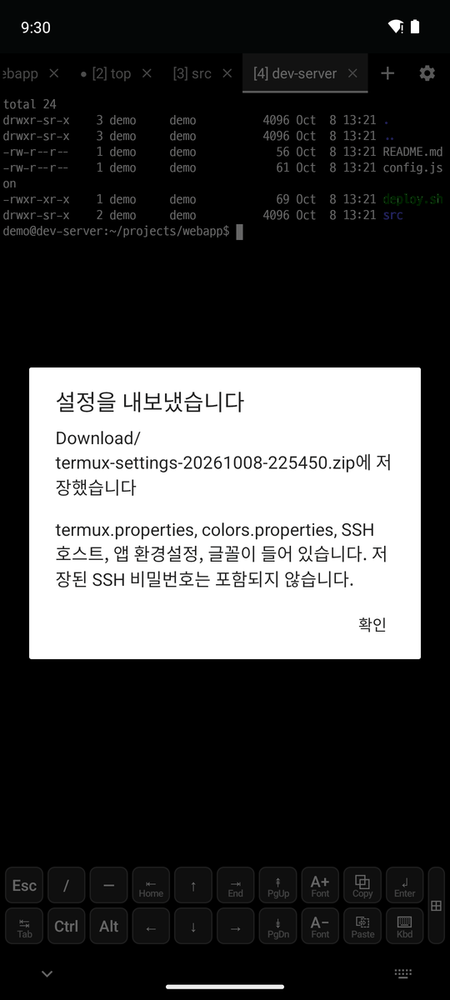
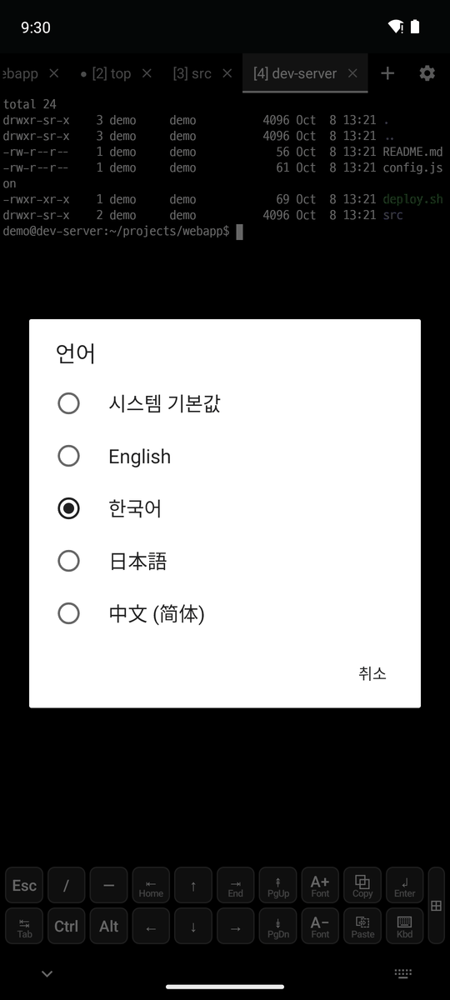
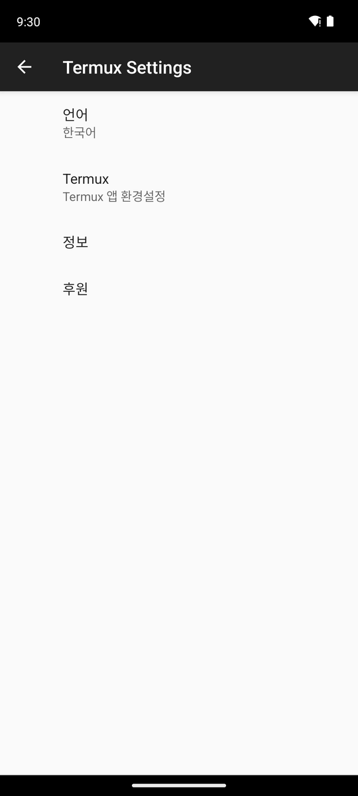
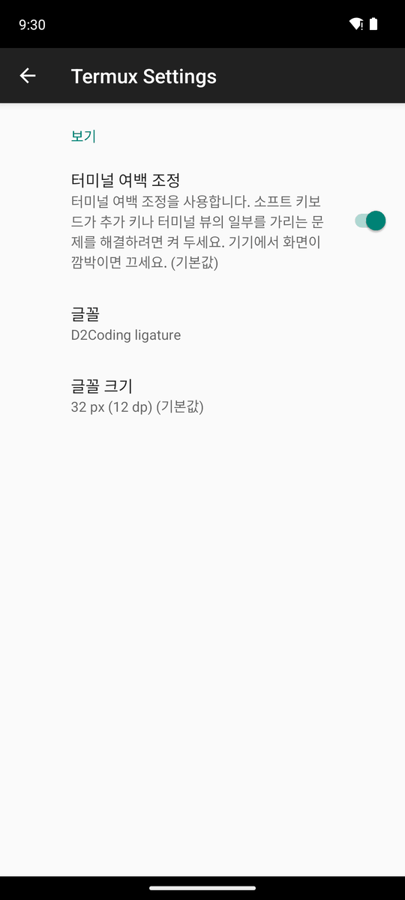

# 7. 설정과 언어

[← SFTP 파일 탐색](6-sftp.md) · [목차](README.md) · [다음: 데이터베이스 →](8-database.md)

## 설정 내보내기/가져오기

- **⚙ → 설정 내보내기**: `Download/termux-settings-*.zip` 파일 하나로 저장합니다.
  - 들어가는 것: `termux.properties`, 색상, SSH 호스트, 스니펫, 특수 키 즐겨찾기, 앱 설정, 글꼴, DB 접속, 저장한 쿼리
  - SSH와 DB 비밀번호는 기기 밖으로 나갈 수 없어서 포함되지 않습니다. 새 기기에서 다시 입력합니다.
- **⚙ → 설정 가져오기**: **파일 선택**으로 zip 파일을 고릅니다. 기존 파일은 `~/.termux/backup/`에 백업합니다.

## 앱 언어

 

- **⚙ → 언어** 또는 설정 → **언어**에서 시스템 기본값, English, 한국어, 日本語, 中文(简体) 중에서 고릅니다.
- 앱을 다시 시작하지 않아도 바로 바뀝니다. 시스템 기본값이면 기기 언어를 따릅니다.

## 설정 화면

**⚙ → 설정** → DevShell → **Terminal View**에서 글꼴과 저장되는 글꼴 크기를 바꿀 수 있습니다. 그 밖의 설정은 `~/.termux/termux.properties`에 있고, **⚙ → termux.properties 편집**으로 열 수 있습니다.

## 셸 첫 화면

새 탭의 로컬 셸은 DevShell 안내로 시작합니다: 설명서, 새 버전, 문제 신고 링크, `pkg` 사용법, 바로가기. 앱 언어로 표시됩니다.

- 패키지(bash, ssh, git 등)는 Termux 저장소에서 받으므로 패키지 문제는 안내에 나온 Termux 링크로 신고합니다. 앱 문제는 이 저장소의 이슈로 신고합니다.
- 안내는 `~/.termux/motd.sh`입니다. 앱이 앱 언어, 릴리즈 버전, 빌드 날짜에 맞춰 다시 씁니다.
  - 직접 고치려면 파일 안의 `# devshell-managed` 줄을 지웁니다. 그러면 앱이 더 이상 바꾸지 않습니다.
  - 안내를 보지 않으려면 `touch ~/.hushlogin`을 실행합니다.

## 정보와 도움말

- **설정 → 정보**: DevShell 저장소, 릴리즈, 설명서, 문제 신고 링크와 앱·기기 정보를 보여 줍니다.
- 왼쪽 서랍의 **도움말**은 이 사용 설명서를 엽니다.
